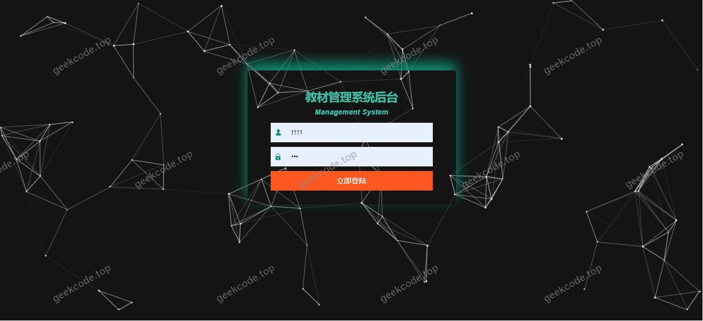
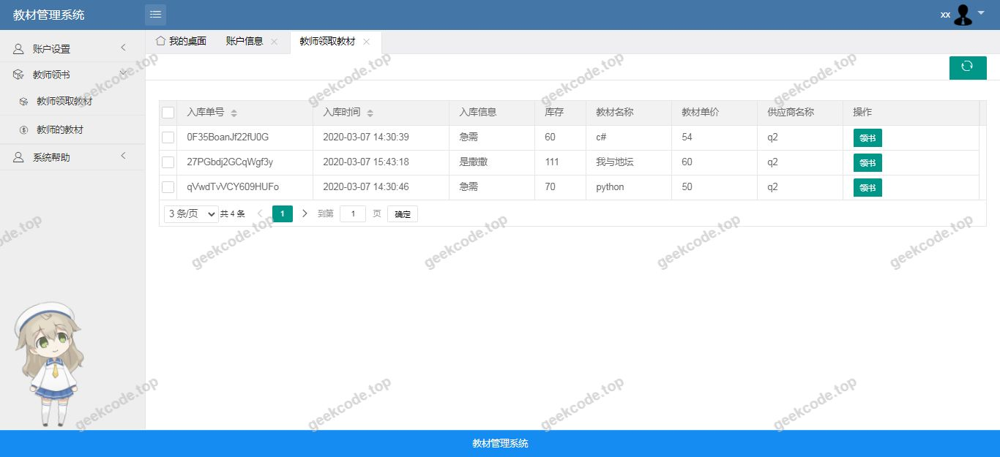
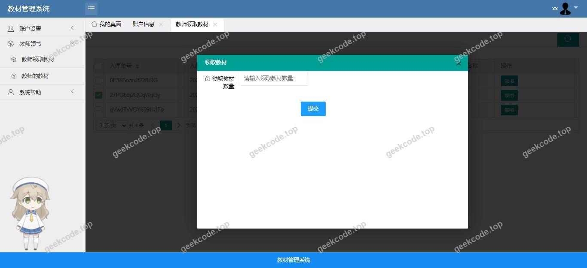
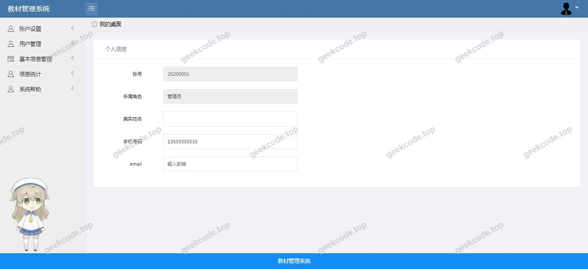
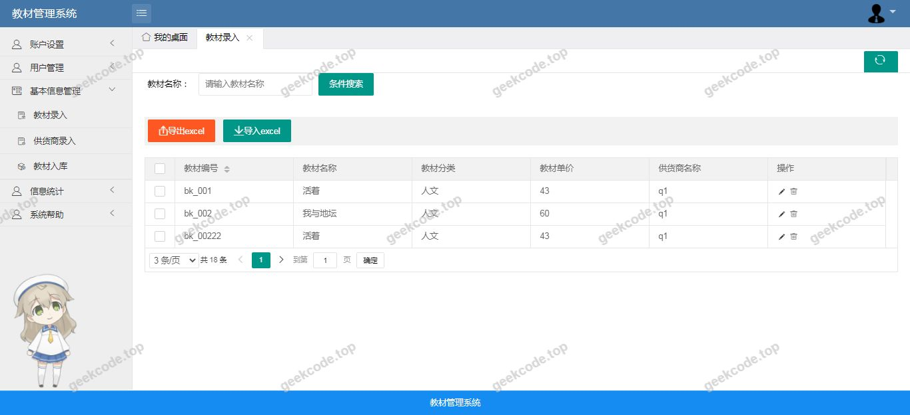
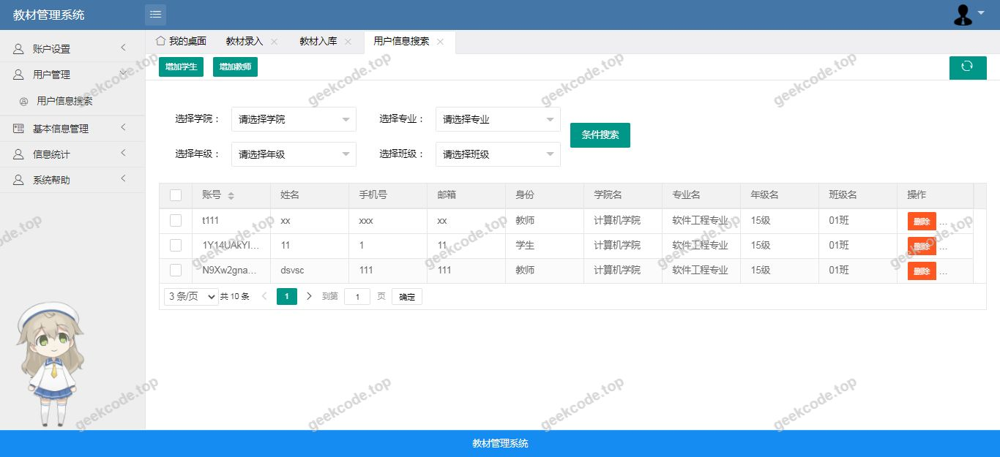

# java精品项目-基于ssm教材管理系统

> 🎓 **计算机毕业设计 · java精品项目-基于ssm教材管理系统**
>
> 本仓库只放**项目介绍 + 运行截图**（截图是站点带水印的原图，存在仓库 `images/` 里）。
>
> 👉 **完整可运行源码 / 数据库脚本 / 部署文档：[点我获取](https://geekcode.top/archives/java%E7%B2%BE%E5%93%81%E9%A1%B9%E7%9B%AE-%E5%9F%BA%E4%BA%8Essm%E6%95%99%E6%9D%90%E7%AE%A1%E7%90%86%E7%B3%BB%E7%BB%9F?utm_source=github)**
>
> 💬 咨询微信：**ir9372**　|　🌐 更多项目：[极客代码 geekcode.top](https://geekcode.top/?utm_source=github)
>
> 📌 项目详情页：<https://geekcode.top/archives/java%E7%B2%BE%E5%93%81%E9%A1%B9%E7%9B%AE-%E5%9F%BA%E4%BA%8Essm%E6%95%99%E6%9D%90%E7%AE%A1%E7%90%86%E7%B3%BB%E7%BB%9F?utm_source=github>

<table><td width="230" align="center"> <b>扫码加微信 ir9372</b></td><td valign="middle">📦 源码 = 项目介绍 + 全部运行截图 + 数据库 + 部署文档 👉 点上方任意截图，直接跳到 <b>极客代码 geekcode.top</b> 详情页</td></table>

---

<h1>java精品项目-基于ssm教材管理系统</h1>
<h2>项目概述</h2>

本项目名为“java精品项目-基于ssm教材管理系统”，旨在构建一个高效、稳定的教材资源管理平台。系统核心功能聚焦于教材数据的数字化管理，包括教材信息的录入、查询、更新及删除等操作，解决传统纸质或分散式教材管理效率低下的问题。适用人群主要为学校教务处工作人员、图书馆管理员及需要维护教材库存的管理人员。技术架构采用经典的SSM框架组合（Spring + Spring MVC + MyBatis），前端界面基于JSP技术实现，后端通过Java语言处理业务逻辑，数据持久层依赖MySQL数据库。虽然项目名称提及“Spring Boot”，但根据提供的代码上下文和技术栈列表（MyBatis, WebSocket, jsp等）以及依赖项（javaee-api, c3p0等），该项目实际呈现为传统的SSM架构特征，而非典型的Spring Boot自动化配置风格，因此文档将严格依据提供的技术依赖进行描述。

<h2>技术架构</h2>
<h3>前后端架构</h3>

系统采用MVC设计模式进行分层开发：

<ul>
<li><strong>表现层</strong>：使用JSP（JavaServer Pages）作为前端视图技术，负责用户界面的渲染和数据展示。由于项目中未提供明确的前台导航菜单和后台路由定义，且截图仅显示系统运行界面，推测其为单体应用架构，页面跳转可能通过Servlet或简单的URL映射实现。</li>
<li><strong>控制层</strong>：基于Spring MVC框架，负责接收HTTP请求，调用业务逻辑层方法，并返回相应的视图或数据响应。</li>
<li><strong>业务逻辑层</strong>：由Spring容器管理Bean的生命周期和依赖注入，处理核心的教材管理业务逻辑。</li>
<li><strong>数据访问层</strong>：采用MyBatis作为ORM框架，通过XML配置文件或注解方式映射SQL语句，实现对MySQL数据库的操作。</li>
</ul>
<h3>核心技术选型理由</h3>
<ul>
<li><strong>MyBatis</strong>：相比Hibernate，MyBatis提供了更灵活的SQL控制能力，适合对性能要求较高且SQL逻辑复杂的教材查询场景。</li>
<li><strong>WebSocket</strong>：在技术栈中列出，表明系统可能具备实时通信能力，例如用于消息通知或在线状态监控，但在现有信息中未见具体应用场景描述。</li>
<li><strong>c3p0连接池</strong>：用于管理数据库连接，提高并发访问时的资源复用率，保障系统稳定性。</li>
<li><strong>Jackson/Fastjson</strong>：用于JSON数据的序列化和反序列化，支持前后端数据交互及API接口输出。</li>
</ul>
<h3>数据库设计要点</h3>

数据存储于MySQL数据库中，主要涉及教材实体表。鉴于缺乏具体的DDL脚本，无法确定详细的字段结构，但基于教材管理系统的通用需求，通常包含教材ID、书名、作者、出版社、ISBN、价格、库存数量、分类标签等基础字段。

<h2>功能模块</h2>

根据现有提供的截图列表（系统运行界面1至6）及技术栈信息，可推断出以下核心功能模块。由于未提供详细的路由和菜单配置，部分功能细节需结合常规教材管理系统逻辑进行界定，但不超出已知技术范围。

<h3>核心业务模块</h3>
<ol>
<li>
<strong>教材信息管理</strong>

<ul>
<li><strong>功能描述</strong>：实现对教材基本信息的增删改查操作。用户可以通过界面输入教材名称、作者、ISBN等信息进行录入；支持按条件筛选查询教材列表；可对已有教材信息进行修改或删除。</li>
<li><strong>对应截图</strong>：系统运行界面1-4可能涵盖列表展示、新增表单、编辑页面及详情查看。</li>
</ul>
</li>
<li>
<strong>数据可视化与统计</strong>

<ul>
<li><strong>功能描述</strong>：对教材数据进行汇总展示，如各类别教材数量统计、库存预警等。利用WebSocket技术，可能在特定场景下实现数据的实时刷新或通知推送。</li>
<li><strong>对应截图</strong>：系统运行界面5-6可能展示统计图表或实时监控面板。</li>
</ul>
</li>
<li>
<strong>系统基础服务</strong>

<ul>
<li><strong>功能描述</strong>：包括用户登录认证（虽未明确提及角色，但管理系统通常具备）、日志记录（Logback-classic依赖支持）、异常处理等基础支撑功能。</li>
</ul>
</li>
</ol>

<em>注：由于项目标记“是否有前台: 否”、“是否有后台: 否”，且无具体路由信息，上述模块归类为统一的系统运行功能，不再强行区分前后台边界，而是视为单一管理界面的不同视图区域。</em>

<h2>用户角色与权限</h2>

根据现有提供的上下文信息，项目中<strong>未明确列出</strong>具体的用户角色（如管理员、教师、学生等）及其对应的权限矩阵。同时，也没有提供后台路由或前台导航菜单来佐证角色的存在。

因此，<strong>根据现有信息无法确定</strong>具体的用户角色划分及细粒度的权限控制策略。在实际部署中，此类系统通常至少包含“超级管理员”角色，拥有所有数据的读写权限；若涉及多用户协作，可能还需定义“普通操作员”角色，仅具备查询和部分录入权限。但在本毕设文档中，必须严格遵守不编造原则，故仅陈述当前信息缺失的状态。

<h2>项目特色与创新点</h2>
<ol>
<li>
<strong>经典SSM架构的稳定实践</strong>
项目采用了成熟且广泛应用的Spring+Spring MVC+MyBatis技术栈，结构清晰，耦合度低，便于维护和扩展。对于毕业设计而言，完整展示了企业级Java Web开发的规范流程。

</li>
<li>
<strong>集成WebSocket实时通信技术</strong>
在传统教材管理系统中引入WebSocket协议，突破了HTTP请求-响应模式的局限性。尽管具体应用场景未在文本中详述，但该技术的引入暗示了系统具备双向通信能力，可用于实现库存变动实时提醒、协同编辑通知等高阶功能，提升了用户体验的即时性。

</li>
<li>
<strong>高性能数据序列化方案</strong>
同时集成了Jackson和Fastjson两种主流JSON处理库，展现了项目在数据交换层面的灵活性。可根据不同业务场景选择最优的序列化引擎，确保数据传输的高效性和兼容性。

</li>
<li>
<strong>完善的日志与测试体系</strong>
依赖中包含<code>logback-classic</code>用于生产环境的日志记录，以及<code>junit</code>用于单元测试。这表明项目在开发过程中注重代码质量和运行监控，符合软件工程的最佳实践标准。

</li>
</ol>
<h2>部署环境</h2>

为确保系统正常运行，需准备以下软件环境：

<table>
<thead>
<tr>
<th align="left">组件</th>
<th align="left">版本/类型要求</th>
<th align="left">说明</th>
</tr>
</thead>
<tbody><tr>
<td align="left"><strong>操作系统</strong></td>
<td align="left">Windows / Linux / macOS</td>
<td align="left">推荐Linux服务器用于生产部署</td>
</tr>
<tr>
<td align="left"><strong>JDK</strong></td>
<td align="left">Java 8 或更高版本</td>
<td align="left">依赖<code>javaee-api</code>，需确保Servlet容器兼容</td>
</tr>
<tr>
<td align="left"><strong>Web容器</strong></td>
<td align="left">Tomcat 8.x / 9.x</td>
<td align="left">由于是JSP项目，需外部Servlet容器支持</td>
</tr>
<tr>
<td align="left"><strong>数据库</strong></td>
<td align="left">MySQL 5.7 / 8.0</td>
<td align="left">存储教材数据，需安装并初始化相关表结构</td>
</tr>
<tr>
<td align="left"><strong>构建工具</strong></td>
<td align="left">Maven</td>
<td align="left">用于管理依赖（如mybatis, c3p0, jackson等）</td>
</tr>
<tr>
<td align="left"><strong>IDE</strong></td>
<td align="left">IntelliJ IDEA / Eclipse</td>
<td align="left">开发调试环境</td>
</tr>
</tbody></table>

<strong>启动步骤简述：</strong>

<ol>
<li>配置<code>pom.xml</code>中的数据库连接参数（URL, Username, Password）。</li>
<li>执行SQL脚本初始化MySQL数据库。</li>
<li>使用Maven打包项目生成WAR包。</li>
<li>将WAR包部署至Tomcat服务器的<code>webapps</code>目录。</li>
<li>启动Tomcat，通过浏览器访问项目根路径即可进入系统运行界面。</li>
</ol>
<h2>五、技术特性</h2>
<ul>
<li>服务端模板渲染（JSP）</li>
</ul>
<h2>六、功能模块截图</h2>
<h3>前台用户端</h3>
<h4>系统运行界面1</h4>

<h4>系统运行界面2</h4>

<h4>系统运行界面3</h4>

<h4>系统运行界面4</h4>

<h4>系统运行界面5</h4>

<h4>系统运行界面6</h4>

---

## 获取完整源码

| 项目 | 说明 |
| --- | --- |
| 项目名 | java精品项目-基于ssm教材管理系统 |
| 运行截图 | 本文 6 张（站点带水印原图，仓库 `images/` 目录） |
| 完整源码 | [https://geekcode.top/archives/java%E7%B2%BE%E5%93%81%E9%A1%B9%E7%9B%AE-%E5%9F%BA%E4%BA%8Essm%E6%95%99%E6%9D%90%E7%AE%A1%E7%90%86%E7%B3%BB%E7%BB%9F?utm_source=github](https://geekcode.top/archives/java%E7%B2%BE%E5%93%81%E9%A1%B9%E7%9B%AE-%E5%9F%BA%E4%BA%8Essm%E6%95%99%E6%9D%90%E7%AE%A1%E7%90%86%E7%B3%BB%E7%BB%9F?utm_source=github) |
| 咨询微信 | **ir9372**（备注：jingpin-yuanma） |
| 更多项目 | [极客代码 geekcode.top](https://geekcode.top/?utm_source=github) |

> 需要源码、部署、改配置、跑不起来等问题，加微信 ir9372 沟通，说明项目名即可。
